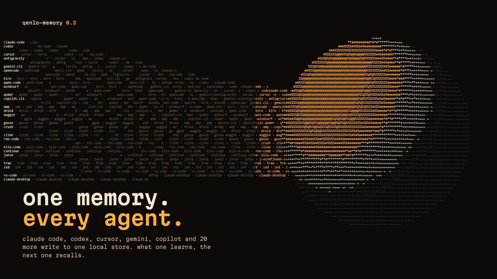
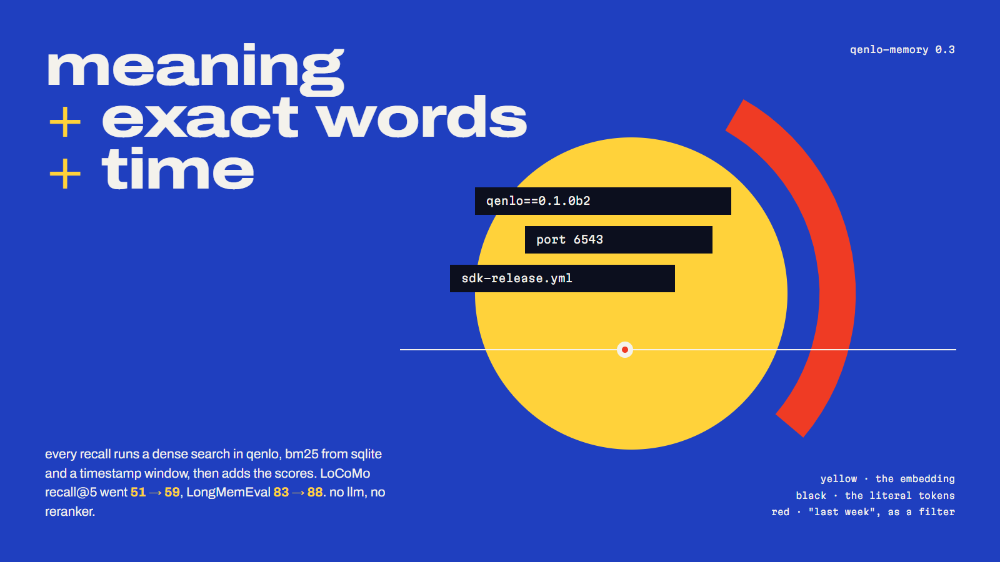
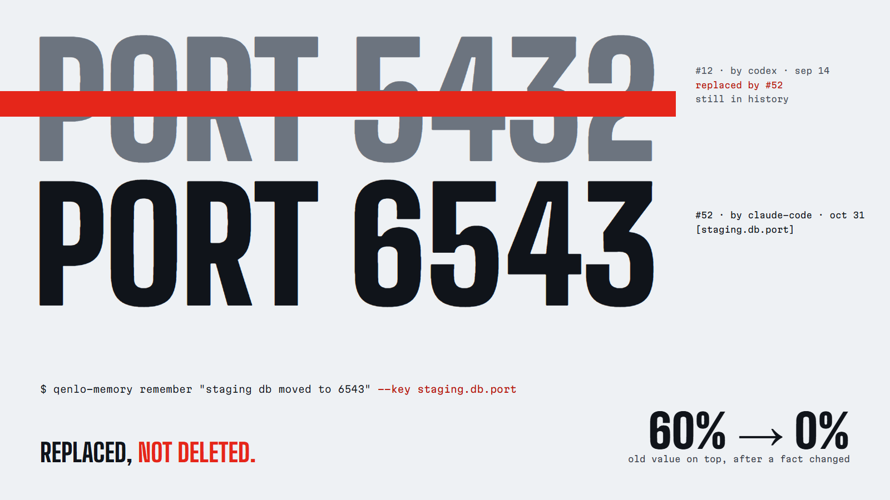
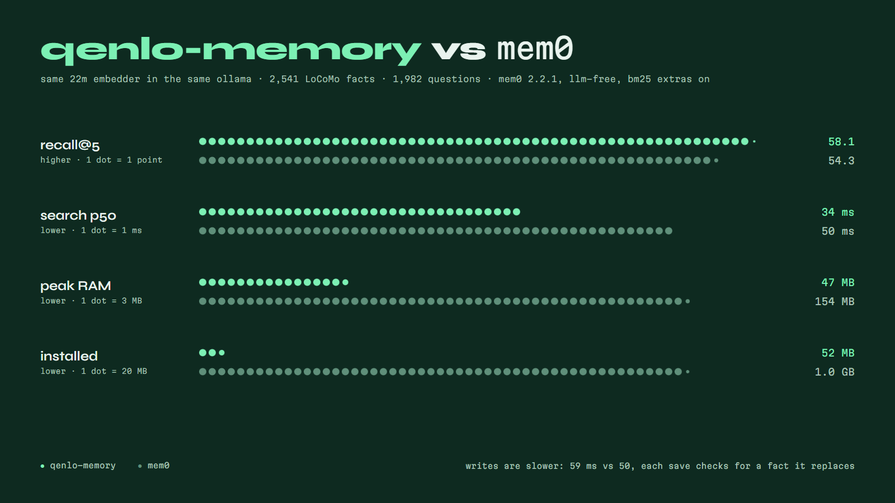

# qenlo-memory



i use claude code, codex, cursor, antigravity, gemini cli and copilot. each one starts every session knowing nothing, and none of them knows what the others figured out an hour ago. so the same release steps, the same preferences and the same "no, we tried that" get explained again, once per agent.

qenlo-memory is one local memory that all of them share. it's a CLI your agents run from their shell, one brain folder they all link to, and hooks. an MCP server is still there for agents without a shell. every agent can read everything, and every memory records which agent wrote it, so `recall` might hand claude code a fix that codex found yesterday, labeled `by codex`.

it runs on [qenlo](https://github.com/a3ro-dev/qenlo), the embedded vector database i'm building, through its python sdk (`qenlo==0.1.0b2`). building a real product on it was also a way to find out where it hurts.

## install

mac and linux:

```bash
curl -fsSL https://raw.githubusercontent.com/a3ro-dev/qenlo-memory/main/install.sh | sh
```

windows (powershell):

```powershell
irm https://raw.githubusercontent.com/a3ro-dev/qenlo-memory/main/install.ps1 | iex
```

the script installs [uv](https://docs.astral.sh/uv/) if you don't have it, installs the `qenlo-memory` CLI with it (the only dependencies are `qenlo` and `mcp`), and runs `qenlo-memory install`. that installs [ollama](https://ollama.com) if it's missing (winget or the official installer on windows, brew or the app on a mac, the official script on linux), starts it if it's stopped, and pulls the embedding model with a progress bar. ollama does the embeddings, on your GPU if you have one. that last step writes the brain folder, `~/.qenlo-memory/brain/`, then finds every coding agent on the machine and links the skill and the always-on instruction into it, lets the agent run `qenlo-memory` without asking where it can, and adds hooks where the agent supports them. `install --mcp` also wires the MCP server into every agent. it backs up each file it edits to `<file>.bak` once, and running it again only replaces its own entries. `qenlo-memory install --dry-run` shows what it would touch without writing anything.

qenlo publishes wheels for windows x64, linux x86_64 and apple silicon macs. intel macs and linux arm aren't covered yet.

then restart your agents. run the same line again to upgrade. the upgrade rewrites the brain, and every agent sees it through its links. on windows it stops the running copies of the MCP server first, because windows won't replace files that are in use.

## what it wires up

```
~/.qenlo-memory/brain/
  RULES.md        the always-on instruction
  skill/SKILL.md  the skill
  profile.md      your long-term memories, rewritten whenever one changes
```

| agent | skill (link to brain/skill) | instructions | hooks |
| --- | --- | --- | --- |
| claude code | `~/.claude/skills` | `~/.claude/rules/qenlo-memory.md` (link) | SessionStart, UserPromptSubmit |
| codex (cli, app, ide) | `~/.agents/skills`, `~/.codex/skills` | `~/.codex/AGENTS.md` | `~/.codex/hooks.json` |
| cursor (ide, cursor-agent) | `~/.agents/skills` | `~/.cursor/rules/qenlo-memory.mdc` | `~/.cursor/hooks.json` |
| antigravity (app, ide, `agy`) | `~/.gemini/config/skills` | `~/.gemini/config/rules/qenlo-memory.md` (link) | no |
| gemini cli | `~/.agents/skills` | `~/.gemini/GEMINI.md` | SessionStart, BeforeAgent |
| opencode | `~/.agents/skills` | `~/.config/opencode/AGENTS.md` | no |
| copilot cli | `~/.copilot/skills` | `~/.copilot/copilot-instructions.md` | no |
| amp | `~/.agents/skills` | `~/.config/amp/AGENTS.md` | no |
| factory droid | `~/.factory/skills` | `~/.factory/AGENTS.md` | no |
| auggie | `~/.augment/skills` | `~/.augment/rules/qenlo-memory.md` (link) | no |
| goose | `~/.config/goose/skills` | `~/.config/goose/.goosehints` | no |
| roo code, continue, cline | `~/.agents/skills` where read | `~/.roo/rules`, `~/.continue/rules`, `~/Documents/Cline/Rules` (links) | no |
| kiro, qwen, qoder, windsurf, crush, kilo, junie, trae | where supported | where supported | no |
| vs code, zed, claude desktop | MCP only, with `install --mcp` | | |

files that are only ours are links into the brain. files you write in too (`AGENTS.md`, `GEMINI.md`...) get a short marked block that points at the brain instead, because a link would take the whole file. directories are symlinks, or junctions on windows, which need no admin. file links need developer mode on windows; without it you get a copy that the next install refreshes.

claude code and gemini cli get `qenlo-memory` added to their shell allowlist, so recalls don't ask for permission. codex keeps the MCP server even without `--mcp`: its sandbox blocks network by default, and the CLI reaches the daemon over localhost. running `install` without `--mcp` takes the old MCP entries out of every other agent.

it only touches agents whose config directory already exists.

the hook loads your long-term memories and the latest ones for the current project into the agent's context at session start. agents without hooks get the same from the skill and the instruction, as long as they actually follow it. codex asks you to trust new hooks before it runs them, so open codex once after installing and approve the qenlo-memory hook.

it used to log every prompt too. in three days that was 175 of my 288 memories, things like "push to gh" and whole pasted chats, some with passwords in them, and they buried the real ones in recall. a prompt isn't a memory. the conclusion an agent writes down after the work is, so that's what episodic holds now.

## how it works

```
claude code ─┐ shell   qenlo-memory recall/remember   (thin client)
cursor ──────┤ ─────>        │
gemini ──────┤               │
codex ───────┤ stdio   qenlo-memory mcp          (codex, and anything wired with --mcp)
antigravity ─┘ ─────>        │ http, 127.0.0.1:7437, token in ~/.qenlo-memory/token
hooks ────────────>          v
                     qenlo-memory serve          (one daemon, started on first use)
                       ├─ ollama                 embeddings, on the GPU
                       ├─ qenlo collection       vectors + search
                       └─ sqlite                 text, kind, agent, project, time
```

the daemon exists because of how qenlo works. it takes an exclusive process lock on a collection. if every agent launched its own server against the same store, the first one would win and the rest would get `collection is already open by another handle or process`. so there's exactly one owner. everything else is a thin client that starts the daemon if it isn't already running.

attribution comes from the shell. agents set environment variables for the commands they run: `AI_AGENT` is becoming the shared one (claude code sets `claude-code_<version>_agent`), and there are per-harness ones like `CLAUDECODE` and `GEMINI_CLI`. when none match, the memory is written `by cli` and the instruction asks the agent to pass `--agent`. over MCP, the name comes from the handshake instead: every client sends its own name (`codex-mcp-client`, `cursor-vscode`, ...), and the server maps that to a short label.

### recall: meaning, words, and time



0.2 searched by meaning alone. a 22M-parameter embedding model is small enough to run anywhere, and small enough to blur exactly what agents remember: names, ports, versions, paths. so 0.3 searches three ways and adds the scores:

- **meaning**: the query's embedding against every current memory, exact search in qenlo.
- **words**: bm25 over sqlite's FTS5 index, which ships with python. scaled by its best hit, and trusted only as far as that hit is real evidence, because in a store of a few memories every word is common and bm25 is noise.
- **time**: if the query names one ("yesterday", "last week", "in september", "3 days ago"), a second dense search restricted to that window. qenlo filters timestamps natively, so this costs one more exact search.

`0.5 · meaning + 0.5 · words + 0.25 · time`, each normalised per query. the recipe came out of a [closed-loop study](research/findings.md) of about sixty memory papers, measured on LoCoMo and LongMemEval with the default model:

| | LoCoMo facts R@5 | LoCoMo turns R@5 | LongMemEval-S recall@5 |
| --- | ---: | ---: | ---: |
| 0.2, meaning only | 51.3 | 45.1 | 83.1 |
| 0.3 | **58.7** | **57.6** | **87.7** |

on the LoCoMo questions that name a time, the time channel alone adds 6 points. a recency bonus, the obvious other idea, made things worse.

### when a fact changes



an old port or a reversed decision that keeps coming back is worse than no memory. in a test with 20 facts that change and 200 distractors, plain append-only memory put the stale value on top 60% of the time.

so `remember` now shows the memories its new fact is probably about (cosine ≥ 0.82, tuned on my real memories), and `--replaces <id>` links them: the old one leaves search, and `history <id>` still shows it as "replaced by #new". with that, the new value was on top 20 out of 20 times, and the related list caught every old version. the store doesn't guess what counts as an update. the agent calling it is the LLM that can tell, so the store gives it the candidates and keeps the chain (the same invalidate-don't-delete idea as zep, engram and tepa).

```bash
qenlo-memory remember "the daemon listens on 7438" --kind semantic
#   remembered #52
#   related memories. if #52 updates one of them, run the same remember again with --replaces <id> ...
#   #12 semantic | by codex | ... | the daemon listens on 7437
qenlo-memory remember "the daemon listens on 7438" --kind semantic --replaces 12
qenlo-memory history 12
```

for facts that are made to change, the agent can name the slot instead: `--key staging.db.port`. the next memory with that key in the same project replaces the old one, with no id and no similarity guess. the agent writing the memory is already an LLM, so it does the structuring at write time and the store never needs one. in the update test, keys alone kept the new value on top 20 out of 20 times.

memories saved before any of this are append-only. `qenlo-memory review` groups the ones that look like the same fact written twice, using qenlo's exact search over every memory, so an agent can link the stale ones. on my own 243 memories it found 31 groups. the first one was a release that one memory called "not merged to prod" and a later one called "deployed".

`qenlo-memory export` writes everything as json lines, replaced versions included, and `qenlo-memory import <file>` reads that back, or a mem0 export.

### four kinds of memory

| kind | what goes in it | example |
| --- | --- | --- |
| `episodic` | things that happened, timestamped. decisions, fixes, how a session ended | "fixed the windows npm dll path, 2026-09-26" |
| `semantic` | facts about you, a project, a tool | "the qenlo python sdk needs `==0.1.0a11`, plain pip skips pre-releases" |
| `procedural` | how to do something | "release: tag, run sdk-release.yml, verify SHA256SUMS" |
| `long_term` | durable facts about you, loaded into every session | "prefers the smallest diff that works" |

each kind is stored in qenlo's `user_id` field. qenlo can only filter on `user_id` and `timestamp`, so kind filters and time filters run inside the vector search itself. agent and project filters over-fetch and then trim.

### the model

the default is `snowflake-arctic-embed:22m` through ollama. it has 22M parameters and 384 dimensions, it's Apache-2.0, and it takes 39MB of VRAM on my rtx 4050. its model card reports 50.15 NDCG@10 on MTEB retrieval, which is a lot for something that small.

`qenlo-memory models` lists the library: twelve ollama embedding models from 46 MB to 1.2 GB (arctic v1 and v2, nomic, mxbai, bge-m3, embeddinggemma, qwen3-embedding, granite, minilm), with their dimension, size, and the query and document prefixes each one was trained with. `qenlo-memory models use nomic-embed-text` pulls the model, makes it the default, and restarts the daemon, which re-embeds every memory from sqlite into a fresh collection, because two models' vectors don't share a space. any other ollama tag works too, without prefixes. `QENLO_MEMORY_MODEL` still overrides the choice for one shell.

i started with torch and sentence-transformers in the daemon. that meant a 2GB CUDA download to run a 22M-parameter model, while ollama was already sitting on the GPU. so embeddings go through ollama's local http api, and this package has no ML dependencies at all.

on the GPU: ollama runs the embeddings there when it can. qenlo searches on the CPU until the store holds 4,096 memories, and from the next daemon start after that it opens in `automatic` mode, which uses the GPU through wgpu once that many memories match a query. qenlo's router makes the same call below 4,096 rows, because moving a small matrix to the GPU costs more than searching it, and bringing wgpu up at all costs about 200 MB of RAM. `qenlo-memory stats` shows where both actually ran.

## numbers

measured on my laptop (rtx 4050, ollama 0.34.4) on a copy of my own store, 243 real memories written by my agents (`research/src/footprint.py`):

| | p50 | p95 |
| --- | --- | --- |
| `recall`, end to end (embed the query, dense + keyword + time search, sqlite join) | 37 ms | 51 ms |
| `remember` (embed, sqlite, qenlo WAL, related-memory check) | 43 ms | 57 ms |
| process RAM with the store open | 43 MB | (python alone: 35 MB) |
| disk | 0.9 MB | |
| installed | 52 MB | |

most of a recall is the embedding call to ollama. the vector search is exact, not approximate, and at this size it's a rounding error. these are in-process numbers, and the MCP hop from an agent adds a local http request on top.

### against mem0



same embedding model in the same ollama, the same 2,541 LoCoMo facts and 1,982 questions, each system's own add and search code, mem0 2.2.1 on its llm-free path (`infer=False`, local qdrant). `research/src/vs_mem0.py` runs both.

| | recall@5 | search p50 / p95 | add (mean) | peak RAM | installed |
| --- | --- | --- | --- | --- | --- |
| mem0 | 46.6 | 48 / 56 ms | 34 ms | 122 MB | |
| mem0 with `[extras]` (its bm25) | 54.3 | 50 / 60 ms | 50 ms | 154 MB | 1.0 GB |
| qenlo-memory | 58.1 | 34 / 53 ms | 59 ms | 47 MB | 52 MB |

qenlo-memory writes are slower because every save looks for a memory it might replace. mem0, zep and supermemory publish 67-97% on these benchmarks, but those are answer accuracy graded by an llm, with an llm and a server in the loop, so they don't compare to the recall numbers here.

## use it yourself

```bash
qenlo-memory recall "how do we release qenlo"
qenlo-memory recent -n 10 --agent codex
qenlo-memory remember "the user's laptop has an rtx 4050" --kind semantic
qenlo-memory remember "staging moved to port 6543" --replaces 31
qenlo-memory history 31
qenlo-memory forget 12
qenlo-memory export > memories.jsonl
qenlo-memory stats
qenlo-memory models
qenlo-memory stop
```

run plain `qenlo-memory` for a welcome screen. in a terminal, memories come out as cards with the kind, agent and project on top, and `stats` draws who wrote what. piped, which is how agents run it, it's the same one-line-per-memory text as always. `NO_COLOR` turns the styling off and `FORCE_COLOR` turns it on.

## what building it on qenlo taught me

qenlo was alpha when this started, and this project ran into three of its edges. two are design choices, one was a bug.

- records hold only an id, a `user_id`, a timestamp and a vector. there's no payload, so the text and provenance live in sqlite next to the collection and the ids line up.
- deleted ids can never be reused. sqlite's `AUTOINCREMENT` has the same rule, so the two agree for free.
- every write is its own WAL file, and `open` replays them. in alpha.10, `flush()` was supposed to fold them into a snapshot but returned early after every commit, so the WAL only ever grew. building this is how i found it, and [alpha.11](https://github.com/a3ro-dev/qenlo/releases/tag/sdk-v0.1.0-alpha.11) fixes it. qenlo-memory calls `flush()` at startup and every 256 writes. it still rebuilds the collection from sqlite if the two ever disagree, for example after a crash between the two commits.
- an agent's memory is mostly "write one thing, then search": `remember`, then `recall` a moment later. up to alpha.11, every write threw away qenlo's search matrix, so the next search copied the whole collection first. [beta.1](https://github.com/a3ro-dev/qenlo/releases/tag/sdk-v0.1.0-beta.1) keeps every vector once in the buffer search reads, which made add-then-search 13x faster at 2,000 rows and cut memory per row by 40%.

## limits

- it's local and single-user. the daemon only listens on 127.0.0.1 and wants a token from your home directory, but any process running as you can read your memories.
- the antigravity app and the antigravity ide send the same client name. `agy` is told apart by its parent process. the other two both show up as `antigravity`.
- memories written from a shell whose harness sets none of the known variables show up as `by cli` unless the agent passes `--agent`.
- secret redaction is a regex for common key formats. it's a seatbelt, not a guarantee.
- there's no consolidation, reranker or llm in the loop. updates are linked by the agent, not detected by the store; the store only points at the likely candidates.

## license

Apache-2.0, same as qenlo.
